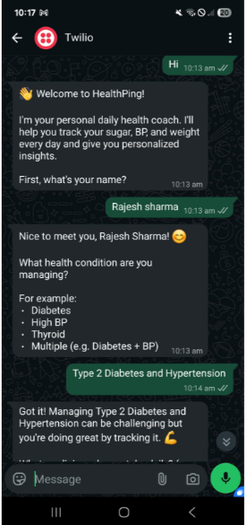
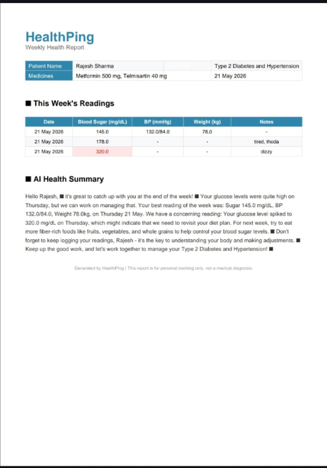
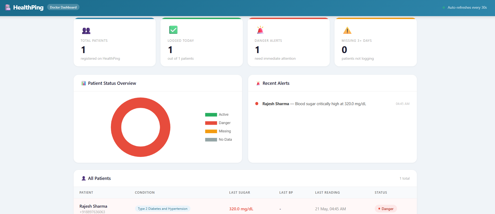

# HealthPing 🏥

Your personal AI health companion on WhatsApp.

## Screenshots

### WhatsApp Conversation

### Weekly PDF Report

### Doctor Dashboard

## What it does
- Daily WhatsApp check-ins for chronic disease patients
- AI extracts health readings from natural language
- Danger alerts for critical readings
- Weekly PDF health reports
- Doctor dashboard with real-time patient monitoring

## Tech Stack
- Python, FastAPI, SQLAlchemy
- Groq (LLaMA 3) for AI
- Twilio WhatsApp API
- ReportLab for PDF generation
- SQLite database

## Features
- Natural language input ("sugar 180 today, feeling tired")
- Multilingual support
- Automated danger threshold detection
- Weekly trend analysis
- Doctor web dashboard with charts